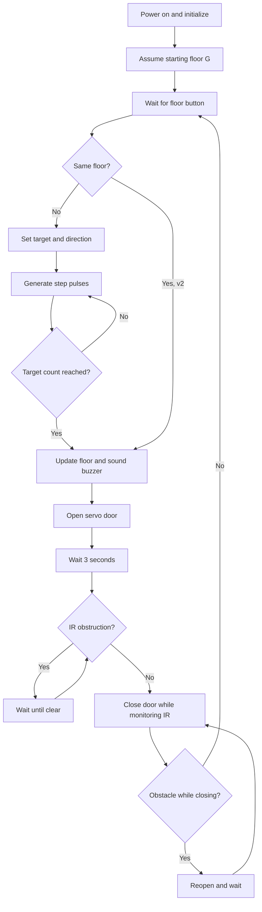
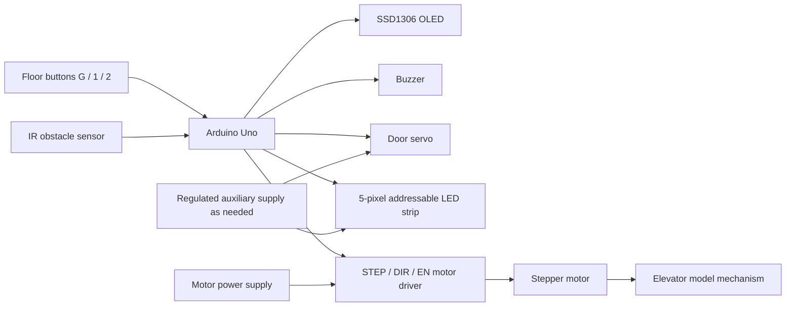
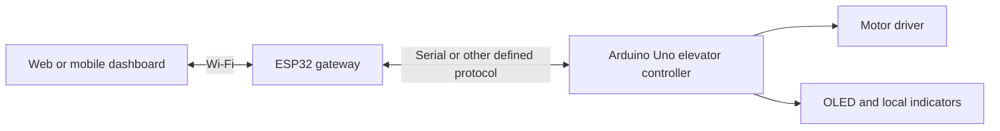

# pinout 

- Arduino UNO
  

| Component     | Arduino Pin |
| ------------- | ----------- |
| STEP          | D2          |
| DIR           | D5          |
| ENABLE        | D8          |
| Button G      | D9          |
| Button 1      | D10         |
| Button 2      | D11         |
| Buzzer        | D6          |
| Servo Signal  | D7          |
| IR Sensor OUT | D12         |
| OLED SDA      | A4          |
| OLED SCL      | A5          |

- Stepper Driver Wiring
  
| Driver Pin | Connect To  |
| ---------- | ----------- |
| STEP       | D2          |
| DIR        | D5          |
| EN         | D8          |
| GND        | Arduino GND |
| VDD        | Arduino 5V  |


# test code 
```
#include <Wire.h>
#include <Adafruit_GFX.h>
#include <Adafruit_SSD1306.h>

#define OLED_RESET -1
Adafruit_SSD1306 display(128, 64, &Wire, OLED_RESET);

// ---------------- PINS ----------------
#define STEP_PIN 2
#define DIR_PIN 5
#define EN_PIN 8

#define BTN_G 9
#define BTN_1 10
#define BTN_2 11

#define BUZZER 6

// ---------------- FLOOR POSITIONS ----------------
// Adjust if needed
const long floorPosition[3] = {0, 1500, 3000};

// ---------------- VARIABLES ----------------
long currentPosition = 0;
long targetPosition = 0;

int currentFloor = 0;
int targetFloor = -1;

bool moving = false;
int direction = 1;

unsigned long lastStepTime = 0;
int stepDelay = 1000;   // Increase if vibration

// =====================================================

void setup() {

  Wire.begin();
  Wire.setClock(100000);

  display.begin(SSD1306_SWITCHCAPVCC, 0x3C);
  display.clearDisplay();
  display.setTextColor(SSD1306_WHITE);

  pinMode(STEP_PIN, OUTPUT);
  pinMode(DIR_PIN, OUTPUT);
  pinMode(EN_PIN, OUTPUT);
  digitalWrite(EN_PIN, LOW);

  pinMode(BTN_G, INPUT_PULLUP);
  pinMode(BTN_1, INPUT_PULLUP);
  pinMode(BTN_2, INPUT_PULLUP);

  pinMode(BUZZER, OUTPUT);

  updateDisplay('-', 0);
}

// =====================================================

void loop() {

  checkButtons();

  if (moving) {
    moveStepper();
  }
}

// =====================================================

void checkButtons() {

  if (!moving) {

    if (digitalRead(BTN_G) == LOW) setTarget(0);
    if (digitalRead(BTN_1) == LOW) setTarget(1);
    if (digitalRead(BTN_2) == LOW) setTarget(2);
  }
}

// =====================================================

void setTarget(int floor) {

  if (floor == currentFloor) return;

  targetFloor = floor;
  targetPosition = floorPosition[floor];

  if (targetPosition > currentPosition) {
    direction = 1;
    digitalWrite(DIR_PIN, HIGH);
  } else {
    direction = -1;
    digitalWrite(DIR_PIN, LOW);
  }

  moving = true;
  updateDisplay(direction == 1 ? '^' : 'v', currentFloor);
}

// =====================================================

void moveStepper() {

  if (micros() - lastStepTime >= stepDelay) {

    lastStepTime = micros();

    if (currentPosition != targetPosition) {

      digitalWrite(STEP_PIN, HIGH);
      delayMicroseconds(5);
      digitalWrite(STEP_PIN, LOW);

      currentPosition += direction;

    } else {

      moving = false;
      currentFloor = targetFloor;

      playArrivalMusic();
      updateDisplay('-', currentFloor);
    }
  }
}

// =====================================================
// 🎵 Elevator Arrival Music
// =====================================================

void playArrivalMusic() {

  int melody[] = {523, 659, 784, 1046}; // C5 E5 G5 C6
  int duration[] = {150, 150, 150, 300};

  for (int i = 0; i < 4; i++) {
    tone(BUZZER, melody[i], duration[i]);
    delay(duration[i] + 50);
  }

  noTone(BUZZER);
}

// =====================================================
// 🖥 OLED Display (Bold Effect)
// =====================================================

void updateDisplay(char arrow, int floor) {

  display.clearDisplay();
  display.setTextColor(SSD1306_WHITE);

  // FLOOR LABEL
  display.setTextSize(3);
  display.setCursor(15, 5);
  display.print("Floor");
  display.setCursor(17, 5);
  display.print("Floor");   // bold effect

  // FLOOR NUMBER
  display.setTextSize(4);

  if (floor == 0) {
    display.setCursor(50, 30);
    display.print("G");
    display.setCursor(52, 30);
    display.print("G");
  } else {
    display.setCursor(50, 30);
    display.print(floor);
    display.setCursor(52, 30);
    display.print(floor);
  }

  // DIRECTION
  display.setTextSize(3);
  display.setCursor(100, 40);

  if (arrow == '^') display.print("^");
  else if (arrow == 'v') display.print("v");
  else display.print("-");

  display.display();
}
```


# v1 test

```
#include <Wire.h>
#include <Adafruit_GFX.h>
#include <Adafruit_SSD1306.h>
#include <Servo.h>

#define OLED_RESET -1
Adafruit_SSD1306 display(128, 64, &Wire, OLED_RESET);

// ---------------- PINS ----------------
#define STEP_PIN 2
#define DIR_PIN 5
#define EN_PIN 8

#define BTN_G 9
#define BTN_1 10
#define BTN_2 11

#define BUZZER 6
#define SERVO_PIN 7

Servo doorServo;

// ---------------- FLOOR POSITIONS ----------------
const long floorPosition[3] = {0, 1500, 3000};

// ---------------- VARIABLES ----------------
long currentPosition = 0;
long targetPosition = 0;

int currentFloor = 0;
int targetFloor = -1;

bool moving = false;
int direction = 1;

unsigned long lastStepTime = 0;
int stepDelay = 1000;

// Door angles
int doorClosed = 0;
int doorOpen = 125;

// =====================================================

void setup() {

  Wire.begin();
  Wire.setClock(100000);

  display.begin(SSD1306_SWITCHCAPVCC, 0x3C);
  display.setTextColor(SSD1306_WHITE);

  pinMode(STEP_PIN, OUTPUT);
  pinMode(DIR_PIN, OUTPUT);
  pinMode(EN_PIN, OUTPUT);
  digitalWrite(EN_PIN, LOW);

  pinMode(BTN_G, INPUT_PULLUP);
  pinMode(BTN_1, INPUT_PULLUP);
  pinMode(BTN_2, INPUT_PULLUP);

  pinMode(BUZZER, OUTPUT);

  doorServo.attach(SERVO_PIN);
  doorServo.write(doorClosed);

  updateDisplay('-', 0);
}

// =====================================================

void loop() {

  checkButtons();

  if (moving) {
    moveStepper();
  }
}

// =====================================================

void checkButtons() {

  if (!moving) {

    if (digitalRead(BTN_G) == LOW) setTarget(0);
    if (digitalRead(BTN_1) == LOW) setTarget(1);
    if (digitalRead(BTN_2) == LOW) setTarget(2);
  }
}

// =====================================================

void setTarget(int floor) {

  if (floor == currentFloor) return;

  targetFloor = floor;
  targetPosition = floorPosition[floor];

  if (targetPosition > currentPosition) {
    direction = 1;
    digitalWrite(DIR_PIN, HIGH);
  } else {
    direction = -1;
    digitalWrite(DIR_PIN, LOW);
  }

  moving = true;
  updateDisplay(direction == 1 ? '^' : 'v', currentFloor);
}

// =====================================================

void moveStepper() {

  if (micros() - lastStepTime >= stepDelay) {

    lastStepTime = micros();

    if (currentPosition != targetPosition) {

      digitalWrite(STEP_PIN, HIGH);
      delayMicroseconds(5);
      digitalWrite(STEP_PIN, LOW);

      currentPosition += direction;

    } else {

      moving = false;
      currentFloor = targetFloor;

      playArrivalMusic();
      updateDisplay('-', currentFloor);

      operateDoor();   // 🚪 AUTO DOOR
    }
  }
}

// =====================================================
// 🚪 DOOR FUNCTION
// =====================================================

void operateDoor() {

  // Open
  for (int pos = doorClosed; pos <= doorOpen; pos++) {
    doorServo.write(pos);
    delay(10);
  }

  delay(5000);  // Door open time (3 seconds)

  // Close
  for (int pos = doorOpen; pos >= doorClosed; pos--) {
    doorServo.write(pos);
    delay(10);
  }
}

// =====================================================
// 🎵 MUSIC
// =====================================================

void playArrivalMusic() {

  int melody[] = {523, 659, 784, 1046};
  int duration[] = {150, 150, 150, 300};

  for (int i = 0; i < 4; i++) {
    tone(BUZZER, melody[i], duration[i]);
    delay(duration[i] + 50);
  }

  noTone(BUZZER);
}

// =====================================================
// 🖥 DISPLAY
// =====================================================

void updateDisplay(char arrow, int floor) {

  display.clearDisplay();

  display.setTextSize(3);
  display.setCursor(15, 5);
  display.print("Floor");
  display.setCursor(17, 5);
  display.print("Floor");

  display.setTextSize(4);

  if (floor == 0) {
    display.setCursor(50, 30);
    display.print("G");
    display.setCursor(52, 30);
    display.print("G");
  } else {
    display.setCursor(50, 30);
    display.print(floor);
    display.setCursor(52, 30);
    display.print(floor);
  }

  display.setTextSize(3);
  display.setCursor(100, 40);

  if (arrow == '^') display.print("^");
  else if (arrow == 'v') display.print("v");
  else display.print("-");

  display.display();
}
```
# v2
```
#include <Wire.h>
#include <Adafruit_GFX.h>
#include <Adafruit_SSD1306.h>
#include <Servo.h>

#define OLED_RESET -1
Adafruit_SSD1306 display(128, 64, &Wire, OLED_RESET);

// ---------------- PINS ----------------
#define STEP_PIN 2
#define DIR_PIN 5
#define EN_PIN 8

#define BTN_G 9
#define BTN_1 10
#define BTN_2 11

#define BUZZER 6
#define SERVO_PIN 7
#define IR_SENSOR 12

Servo doorServo;

// ---------------- FLOOR POSITIONS ----------------
const long floorPosition[3] = {0, 1500, 3000};

// ---------------- VARIABLES ----------------
long currentPosition = 0;
long targetPosition = 0;

int currentFloor = 0;
int targetFloor = -1;

bool moving = false;
int direction = 1;

unsigned long lastStepTime = 0;
int stepDelay = 1000;

int doorClosed = 0;
int doorOpen = 115;

// =====================================================

void setup() {

  Wire.begin();
  Wire.setClock(100000);

  display.begin(SSD1306_SWITCHCAPVCC, 0x3C);
  display.setTextColor(SSD1306_WHITE);

  pinMode(STEP_PIN, OUTPUT);
  pinMode(DIR_PIN, OUTPUT);
  pinMode(EN_PIN, OUTPUT);
  digitalWrite(EN_PIN, LOW);

  pinMode(BTN_G, INPUT_PULLUP);
  pinMode(BTN_1, INPUT_PULLUP);
  pinMode(BTN_2, INPUT_PULLUP);

  pinMode(BUZZER, OUTPUT);
  pinMode(IR_SENSOR, INPUT);

  doorServo.attach(SERVO_PIN);
  doorServo.write(doorClosed);

  updateDisplay('-', 0);
}

// =====================================================

void loop() {

  checkButtons();

  if (moving) {
    moveStepper();
  }
}

// =====================================================

void checkButtons() {

  if (!moving) {

    if (digitalRead(BTN_G) == LOW) setTarget(0);
    if (digitalRead(BTN_1) == LOW) setTarget(1);
    if (digitalRead(BTN_2) == LOW) setTarget(2);
  }
}

// =====================================================

void setTarget(int floor) {

  // 🚪 If already at same floor → open door
  if (floor == currentFloor) {
    playArrivalMusic();
    operateDoor();
    return;
  }

  targetFloor = floor;
  targetPosition = floorPosition[floor];

  if (targetPosition > currentPosition) {
    direction = 1;
    digitalWrite(DIR_PIN, HIGH);
  } else {
    direction = -1;
    digitalWrite(DIR_PIN, LOW);
  }

  moving = true;
  updateDisplay(direction == 1 ? '^' : 'v', currentFloor);
}

// =====================================================

void moveStepper() {

  if (micros() - lastStepTime >= stepDelay) {

    lastStepTime = micros();

    if (currentPosition != targetPosition) {

      digitalWrite(STEP_PIN, HIGH);
      delayMicroseconds(5);
      digitalWrite(STEP_PIN, LOW);

      currentPosition += direction;

    } else {

      moving = false;
      currentFloor = targetFloor;

      playArrivalMusic();
      updateDisplay('-', currentFloor);

      operateDoor();
    }
  }
}

// =====================================================
// 🚪 DOOR CONTROL WITH SAFETY SENSOR
// =====================================================

void operateDoor() {

  // ---------- OPEN ----------
  for (int pos = doorClosed; pos <= doorOpen; pos++) {
    doorServo.write(pos);
    delay(10);
  }

  delay(3000);   // Initial wait

  // ---------- WAIT IF OBSTACLE ----------
  while (digitalRead(IR_SENSOR) == LOW) {   // LOW = obstacle detected
    delay(3000);   // Wait again
  }

  // ---------- CLOSE ----------
  for (int pos = doorOpen; pos >= doorClosed; pos--) {

    // If obstacle detected while closing
    if (digitalRead(IR_SENSOR) == LOW) {

      // Re-open
      for (int p = pos; p <= doorOpen; p++) {
        doorServo.write(p);
        delay(10);
      }

      delay(3000);   // Wait again
      pos = doorOpen;   // Restart closing
    }

    doorServo.write(pos);
    delay(10);
  }
}

// =====================================================
// 🎵 ARRIVAL MUSIC
// =====================================================

void playArrivalMusic() {

  int melody[] = {523, 659, 784, 1046};
  int duration[] = {150, 150, 150, 300};

  for (int i = 0; i < 4; i++) {
    tone(BUZZER, melody[i], duration[i]);
    delay(duration[i] + 50);
  }

  noTone(BUZZER);
}

// =====================================================
// 🖥 OLED DISPLAY
// =====================================================

void updateDisplay(char arrow, int floor) {

  display.clearDisplay();

  display.setTextSize(3);
  display.setCursor(15, 5);
  display.print("Floor");
  display.setCursor(17, 5);
  display.print("Floor");   // Bold effect

  display.setTextSize(4);

  if (floor == 0) {
    display.setCursor(50, 30);
    display.print("G");
    display.setCursor(52, 30);
    display.print("G");
  } else {
    display.setCursor(50, 30);
    display.print(floor);
    display.setCursor(52, 30);
    display.print(floor);
  }

  display.setTextSize(3);
  display.setCursor(100, 40);

  if (arrow == '^') display.print("^");
  else if (arrow == 'v') display.print("v");
  else display.print("-");

  display.display();
}

```
✅ 3 Floors (G,1,2) – Real Step Control

✅ Queue Priority System

✅ Servo Auto Door

✅ IR Safety (3 sec wait logic)

✅ OLED Floor + Arrow

✅ Buzzer Music

✅ 5 LED Addressable Strip Status

✅ Auto Open if same floor button pressed

# updated lights 

- led at D4

Install Libraries

Adafruit SSD1306

Adafruit GFX

Adafruit NeoPixel


```
#include <Wire.h>
#include <Adafruit_GFX.h>
#include <Adafruit_SSD1306.h>
#include <Servo.h>
#include <Adafruit_NeoPixel.h>

#define OLED_RESET -1
Adafruit_SSD1306 display(128, 64, &Wire, OLED_RESET);

// ---------------- PINS ----------------
#define STEP_PIN 2
#define DIR_PIN 5
#define EN_PIN 8

#define BTN_G 9
#define BTN_1 10
#define BTN_2 11

#define BUZZER 6
#define SERVO_PIN 7
#define IR_SENSOR 12

#define LED_PIN 4
#define LED_COUNT 5

Servo doorServo;
Adafruit_NeoPixel strip(LED_COUNT, LED_PIN, NEO_GRB + NEO_KHZ800);

// ---------------- FLOOR POSITIONS ----------------
const long floorPosition[3] = {0, 1500, 3000};

// ---------------- VARIABLES ----------------
long currentPosition = 0;
long targetPosition = 0;

int currentFloor = 0;
int targetFloor = -1;

bool moving = false;
int direction = 1;

unsigned long lastStepTime = 0;
int stepDelay = 1000;

int doorClosed = 0;
int doorOpen = 115;

// =====================================================
// 🌈 LED FUNCTIONS
// =====================================================

void setLED(int r, int g, int b) {
  for (int i = 0; i < LED_COUNT; i++) {
    strip.setPixelColor(i, strip.Color(r, g, b));
  }
  strip.show();
}

void flashRed() {
  setLED(255,0,0);
  delay(200);
  strip.clear();
  strip.show();
  delay(200);
}

// =====================================================

void setup() {

  Wire.begin();
  Wire.setClock(100000);

  display.begin(SSD1306_SWITCHCAPVCC, 0x3C);
  display.setTextColor(SSD1306_WHITE);

  pinMode(STEP_PIN, OUTPUT);
  pinMode(DIR_PIN, OUTPUT);
  pinMode(EN_PIN, OUTPUT);
  digitalWrite(EN_PIN, LOW);

  pinMode(BTN_G, INPUT_PULLUP);
  pinMode(BTN_1, INPUT_PULLUP);
  pinMode(BTN_2, INPUT_PULLUP);

  pinMode(BUZZER, OUTPUT);
  pinMode(IR_SENSOR, INPUT);

  doorServo.attach(SERVO_PIN);
  doorServo.write(doorClosed);

  strip.begin();
  strip.setBrightness(60);
  strip.show();
  setLED(0,255,0);  // Start green

  updateDisplay('-', 0);
}

// =====================================================

void loop() {

  checkButtons();

  if (moving) {
    moveStepper();
  }
}

// =====================================================

void checkButtons() {

  if (!moving) {

    if (digitalRead(BTN_G) == LOW) setTarget(0);
    if (digitalRead(BTN_1) == LOW) setTarget(1);
    if (digitalRead(BTN_2) == LOW) setTarget(2);
  }
}

// =====================================================

void setTarget(int floor) {

  if (floor == currentFloor) {
    playArrivalMusic();
    operateDoor();
    return;
  }

  targetFloor = floor;
  targetPosition = floorPosition[floor];

  if (targetPosition > currentPosition) {
    direction = 1;
    digitalWrite(DIR_PIN, HIGH);
    setLED(0,0,255);     // Blue UP
  } else {
    direction = -1;
    digitalWrite(DIR_PIN, LOW);
    setLED(150,0,150);   // Purple DOWN
  }

  moving = true;
  updateDisplay(direction == 1 ? '^' : 'v', currentFloor);
}

// =====================================================

void moveStepper() {

  if (micros() - lastStepTime >= stepDelay) {

    lastStepTime = micros();

    if (currentPosition != targetPosition) {

      digitalWrite(STEP_PIN, HIGH);
      delayMicroseconds(5);
      digitalWrite(STEP_PIN, LOW);

      currentPosition += direction;

    } else {

      moving = false;
      currentFloor = targetFloor;

      playArrivalMusic();
      updateDisplay('-', currentFloor);
      setLED(0,255,0);   // Green when stopped

      operateDoor();
    }
  }
}

// =====================================================
// 🚪 DOOR WITH IR + LED ALERT
// =====================================================

void operateDoor() {

  // ---------- OPEN ----------
  for (int pos = doorClosed; pos <= doorOpen; pos++) {
    doorServo.write(pos);
    delay(10);
  }

  setLED(0,255,0);
  delay(3000);

  // ---------- WAIT IF OBSTACLE ----------
  while (digitalRead(IR_SENSOR) == LOW) {
    setLED(255,0,0);   // Solid Red
    delay(3000);
  }

  // ---------- FLASH BEFORE CLOSE ----------
  for(int i=0;i<5;i++) flashRed();

  // ---------- CLOSE ----------
  for (int pos = doorOpen; pos >= doorClosed; pos--) {

    if (digitalRead(IR_SENSOR) == LOW) {

      setLED(255,0,0);

      for (int p = pos; p <= doorOpen; p++) {
        doorServo.write(p);
        delay(10);
      }

      delay(3000);
      pos = doorOpen;
    }

    doorServo.write(pos);
    delay(10);
  }

  setLED(0,255,0);  // Back to green
}

// =====================================================
// 🎵 MUSIC
// =====================================================

void playArrivalMusic() {

  int melody[] = {523, 659, 784, 1046};
  int duration[] = {150,150,150,300};

  for (int i=0;i<4;i++) {
    tone(BUZZER, melody[i], duration[i]);
    delay(duration[i]+50);
  }

  noTone(BUZZER);
}

// =====================================================
// 🖥 OLED
// =====================================================

void updateDisplay(char arrow, int floor) {

  display.clearDisplay();

  display.setTextSize(3);
  display.setCursor(15,5);
  display.print("Floor");
  display.setCursor(17,5);
  display.print("Floor");

  display.setTextSize(4);

  if (floor == 0) {
    display.setCursor(50,30);
    display.print("G");
    display.setCursor(52,30);
    display.print("G");
  } else {
    display.setCursor(50,30);
    display.print(floor);
    display.setCursor(52,30);
    display.print(floor);
  }

  display.setTextSize(3);
  display.setCursor(100,40);

  if (arrow=='^') display.print("^");
  else if (arrow=='v') display.print("v");
  else display.print("-");

  display.display();
}
```


Arduino-Based Smart Elevator Prototype
Three-floor automated elevator model | Arduino Uno | Stepper motor | Servo door | IR safety | OLED | Buzzer | NeoPixel
Project status: Educational prototype. The linked repository contains multiple experimental firmware versions. Details below distinguish implemented code behavior from proposed extensions and specifications that must be confirmed against the actual build. Not suitable for carrying people or loads.

Original repository: https://github.com/NavaneethKumar237/elivator_arduino
Maintainer: Navaneeth Kumar
Table of contents
1. Introduction
2. Product overview
3. Objectives and scope
4. Technical specifications
5. System operation
6. Features and benefits
7. Advantages and limitations
8. Components and bill of materials
9. Pinout and wiring
10. Block diagram
11. Circuit diagram and electrical precautions
12. Software architecture
13. Arduino IDE setup
14. Firmware and version history
15. Calibration and configuration
16. Testing and validation
17. Troubleshooting
18. IoT and cloud integration (future scope)
19. Project images
20. Demonstration videos
21. Future improvements
22. Acknowledgments
23. About the developer
24. Conclusion
1. Introduction
An elevator is a vertically moving transport mechanism that travels between defined levels. This educational three-floor elevator prototype demonstrates how embedded electronics can coordinate motor motion, user requests, floor indication, automated doors and obstacle sensing. It is designed as a learning model, not a certified elevator.

The controller reads three floor-select buttons and generates step/direction signals for an external stepper motor driver. A servo actuates the model door, a reflective/obstacle IR module can delay closing, an OLED displays floor and movement direction, and a buzzer plays an arrival melody. A later version of the repository also adds an addressable LED status strip.
2. Product overview
Subsystem	Function	Repository evidence
Arduino Uno	Central control	Existing pinout and firmware
Stepper motor + driver	Vertical model motion	STEP/DIR/EN code
Three push buttons	Select G, 1 or 2	D9, D10, D11
128×64 I²C OLED	Floor and travel direction	SSD1306 code, address 0x3C
Servo motor	Open and close model door	Later firmware versions
IR obstacle module	Detect door-path obstruction	v2 firmware
Buzzer	Arrival melody	Firmware
5-pixel addressable LED strip	Visual status indication	Updated-lights section; verify latest complete implementation


Floor arrangement
Floor	Internal index	Example programmed target position
Ground (G)	0	0 steps
First (1)	1	1500 steps
Second (2)	2	3000 steps


These are example software step counts, not physical distances or validated mechanical dimensions. Actual travel depends on the stepper driver microstepping setting and transmission geometry.
3. Objectives and scope
- Demonstrate embedded motion control with floor selection.
- Display status locally on an OLED.
- Automate door opening/closing with a servo.
- Detect a model door obstruction using an IR sensor.
- Provide audible and visual status feedback.
- Support classroom demonstrations of finite-state control, wiring, testing and calibration.
Out of scope: Passenger safety certification, lifting rated loads, real elevator interlocks, guaranteed position recovery, industrial-grade emergency stop, or remote safety-critical operation.
4. Technical specifications
Parameter	Documented value / status
Controller	Arduino Uno, ATmega328P-based board
Floors	3: G, 1, 2
Motor interface	STEP, DIR and ENABLE to external stepper driver
Motion target positions	0, 1500, 3000 step pulses
STEP pulse high time	5 µs in published versions
Step interval setting	1000 µs in published versions; approximate, subject to loop overhead
OLED	SSD1306, 128×64, I²C, configured at 0x3C
I²C clock	100 kHz in code
Door actuator	Servo; 0° closed, 115° open in v2
IR obstacle logic	LOW interpreted as obstacle in v2 — verify your module
Door initial open wait	3 seconds in v2
User controls	3 buttons, internal pull-ups
Buzzer melody	C5, E5, G5, C6; 523, 659, 784, 1046 Hz
LED strip	5 addressable LEDs mentioned; signal on D4
Motor model / rated current	To be confirmed
Driver model / current setting	To be confirmed
Motor power supply voltage/current	To be confirmed
Physical dimensions / maximum model load	To be measured
Homing / limit switches	Not documented in reviewed code
Wi-Fi / IoT cloud	Not part of documented Arduino Uno baseline


Motion calculation
If one floor spans N step pulses and the mechanism moves d millimetres per step pulse:

Floor travel (mm) = N × d

For a belt or pulley with effective circumference C and motor steps per revolution S, using microstep factor M:

Travel per pulse = C / (S × M)

The 1500-step spacing cannot be converted into millimetres without the actual transmission and microstepping specifications. In the code, position is inferred by counting commanded pulses, not measured by an encoder.
5. System operation
1. On power-up, the sketch initializes the OLED, stepper control pins, buttons, buzzer and—depending on firmware version—the servo and IR sensor.
2. The code assumes the elevator starts at Ground (currentPosition = 0). The software does not home the carriage automatically.
3. The user presses G, 1 or 2. With INPUT_PULLUP, a pressed button reads LOW.
4. When idle, the program maps the floor to a target step count and chooses the motor direction.
5. The controller sends STEP pulses until the internal position counter reaches the target.
6. On arrival, it updates the floor, plays a buzzer melody and updates the OLED.
7. In later versions, the servo opens the model door, waits, and then closes it.
8. In v2, if the IR input indicates an obstruction, the closing process waits or reopens the door.
Important implementation details: The visible v2 implementation ignores new floor button presses while moving is true; although the README mentions a “queue priority system,” the inspected code does not establish a working queue. Its door and melody functions use blocking delay() calls, so button responsiveness is limited during those actions. The displayed floor during motion is the last completed floor, not a sensor-measured instantaneous floor.
Operating flow

6. Features and benefits
Feature	Benefit
Three selectable floors	Simple, demonstrable destination control
Step/direction motor interface	Separates controller logic from motor power electronics
OLED display	Shows floor and travel direction
Automatic servo door	Demonstrates electromechanical sequencing
IR obstacle detection	Introduces basic obstruction-aware door control
Arrival melody	Audible confirmation of arrival
Addressable LED status concept	Additional visual feedback
Editable Arduino firmware	Suitable for experimentation and learning


7. Advantages and limitations
Advantages: Low-complexity educational architecture, accessible Arduino ecosystem, modular peripherals, easy floor-position adjustments, and visible physical operation.

Limitations: No validated homing or end-stop protection; no measured position feedback; no proven request queue; no certified door force protection; timing uses blocking calls; driver electrical specifications are not documented; no authenticated remote monitoring. Never extrapolate this model to a real passenger elevator.
8. Components and bill of materials
Quantities below are inferred from the published firmware and notes. Enter actual supplier prices and part numbers before claiming a total project cost.
#	Component	Qty	Specification / selection note	Unit price (₹)	Subtotal (₹)
1	Arduino Uno-compatible board	1	5 V logic	TBD	TBD
2	Stepper motor	1	Torque and current to suit mechanism	TBD	TBD
3	STEP/DIR stepper driver	1	Must match motor current and voltage	TBD	TBD
4	Push button	3	Momentary, normally open	TBD	TBD
5	SSD1306 OLED	1	128×64, I²C	TBD	TBD
6	Servo motor	1	Sized for model door torque	TBD	TBD
7	IR obstacle sensor	1	Digital output, polarity verified	TBD	TBD
8	Buzzer	1	Compatible with tone()	TBD	TBD
9	Addressable LED strip	1	5 pixels, protocol verified	TBD	TBD
10	Motor power supply	1	Per motor driver datasheet	TBD	TBD
11	Regulated servo/LED supply	1	Sized for peak current	TBD	TBD
12	Wires, connectors, structure, mechanism	As needed	Secure, insulated connections	TBD	TBD
	Total		To be calculated from invoices		TBD


9. Pinout and wiring
Arduino Uno pinout
Device signal	Arduino Uno pin	Notes
Stepper driver STEP	D2	Pulse output
Stepper driver DIR	D5	Direction output
Stepper driver EN	D8	Code drives LOW to enable; verify driver polarity
NeoPixel / addressable LED data	D4	Updated-lights note
Buzzer	D6	tone() output
Servo signal	D7	Servo library
Ground-floor button	D9	Other button terminal to GND
First-floor button	D10	Other button terminal to GND
Second-floor button	D11	Other button terminal to GND
IR sensor OUT	D12	LOW treated as obstruction in v2
OLED SDA	A4	I²C data
OLED SCL	A5	I²C clock


Driver control wiring
Driver logic pin	Arduino connection
STEP	D2
DIR	D5
EN	D8
Logic GND	GND
Logic VDD	5 V only if supported by the selected driver


Do not power the stepper motor from an Arduino I/O pin or its 5 V rail. The driver needs an appropriate motor supply, motor coil wiring, current-limit configuration, and grounding according to its exact datasheet. Some STEP/DIR drivers have different logic supply arrangements; the table above reflects the existing repository, not a universal driver wiring rule.

Power precautions: Use a properly regulated supply for the servo and addressable LEDs when current demand exceeds the board's capacity. Connect signal grounds appropriately, observe logic-level compatibility, and consider decoupling, fusing and cable strain relief. Never connect a motor supply directly to the Uno 5 V pin.
10. Block diagram

11. Circuit diagram and electrical precautions
A verified schematic has not yet been uploaded. Add a schematic image at assets/circuit-diagram.png after confirming the exact driver, motor, supply voltages and connectors.

Recommended schematic labels: controller pin names; driver model; motor coil connections; motor voltage and ground; servo supply; OLED VCC/GND/SDA/SCL; button pull-up arrangement; IR sensor voltage and logic polarity; buzzer; LED strip power and signal.

Mechanical precautions: Provide physical stops, prevent uncontrolled falling or binding, and avoid fingers near gears, pulleys or closing doors. The IR sensor is an educational demonstration input, not a certified safety device.
12. Software architecture
The repository shows these functions in its successive Arduino sketches:
Function	Role
setup()	Initialize display, pins and servo
loop()	Poll buttons and run motor stepping when active
checkButtons()	Read the three destination buttons when idle
setTarget(int floor)	Choose target count and direction
moveStepper()	Send STEP pulses and update software position
playArrivalMusic()	Play a four-note buzzer melody
updateDisplay(char arrow, int floor)	Draw floor label and direction
operateDoor()	Open, wait, monitor IR, close and reopen if obstructed (v2)


Suggested state machine for a future refactor
IDLE → MOVING → ARRIVED → DOOR_OPENING → DOOR_HOLD → DOOR_CLOSING → IDLE

Add separate FAULT and HOMING states once physical sensors are fitted. Use nonblocking millis() timing and a proper request queue if multiple requests during travel are required.
13. Arduino IDE setup
1. Install the Arduino IDE from https://www.arduino.cc/en/software.
2. Connect the Arduino Uno by USB.
3. In Tools → Board, select Arduino Uno; choose the correct serial port.
4. Open Library Manager and install Adafruit GFX Library, Adafruit SSD1306, and Adafruit NeoPixel (needed for the LED version). Wire and Servo are available through the Arduino platform/library ecosystem.
5. Open the appropriate sketch from the existing repository README or move it into a dedicated .ino file.
6. Confirm all motor driver wiring and supply settings before energizing the motor.
7. Compile, upload, and test each subsystem independently.
Suggested repository layout
elivator_arduino/
├── README.md
├── firmware/
│   ├── basic_floor_control/
│   │   └── basic_floor_control.ino
│   ├── automatic_door/
│   │   └── automatic_door.ino
│   ├── ir_safety/
│   │   └── ir_safety.ino
│   └── led_status/
│       └── led_status.ino
├── hardware/
│   ├── schematic.pdf
│   ├── wiring.md
│   └── bom.csv
├── assets/
│   ├── project-front.jpg
│   ├── wiring.jpg
│   ├── circuit-diagram.png
│   └── demo-thumbnail.jpg
├── docs/
│   ├── calibration.md
│   ├── testing.md
│   └── troubleshooting.md
└── LICENSE
The tree is a suggested future organization, not a claim that these files already exist.
14. Firmware and version history
The current GitHub README embeds several code versions. For easier maintenance, separate them into independent, compilable Arduino sketches.
Version label in existing README	Documented behavior
test code	Three floors, stepper control, OLED, buzzer
v1 test	Adds servo-operated automatic door
v2	Adds IR-obstacle-aware door operation and same-floor door reopening
updated lights	Adds addressable LED status hardware/logic; pin D4 noted


Source of truth: https://github.com/NavaneethKumar237/elivator_arduino/blob/main/README.md

The code currently embedded in that README should be preserved exactly in separate versioned .ino files before making modifications. This document intentionally does not invent a new "final tested" sketch or assert that every experimental feature is working simultaneously.
15. Calibration and configuration
Floor step counts
const long floorPosition[3] = {0, 1500, 3000};
Adjust the numbers only after measuring actual model travel. If a carriage moves 1500 steps per floor in the chosen mechanical setup, those counts are appropriate; otherwise they are placeholders.
Door angles
int doorClosed = 0;
int doorOpen = 115;
Check the servo linkage for binding and adjust limits gradually. Never force the horn against a mechanical stop.
Motion speed
int stepDelay = 1000;
This sets the minimum interval between step events in the visible code. Actual speed is affected by the loop and blocking operations. Rapid starting without acceleration may cause missed steps. For reliable operation, consider a ramped-motion library and motor torque calculations.
Starting position
Critical: currentPosition = 0 assumes the carriage is physically at G when the board starts. If it is not, the model may move incorrectly. A future revision should home to a physical switch before accepting commands.
16. Testing and validation
Test	Procedure	Expected observation	Result
Power-on	Start with carriage at known G position	OLED initializes, no unexpected motion	Not recorded
G → 1	Press button 1	Travel to first-floor target	Not recorded
1 → 2	Press button 2	Travel upward to second floor	Not recorded
2 → G	Press G	Travel downward to ground	Not recorded
Same-floor selection	Press current-floor button on v2	Door opens without floor travel	Not recorded
Door sequence	Reach destination	Door opens, waits, closes	Not recorded
Obstacle before closing	Block IR detection path	Door remains open until clear	Not recorded
Obstacle while closing	Block path during closing	Door reopens / closing restarts	Not recorded
OLED	Travel both directions	Floor label and direction update	Not recorded
Buzzer	Reach floor	Arrival melody plays	Not recorded
LED status	Load updated LED sketch	Verify all five pixels and colors	Not recorded
Restart away from G	Power-cycle at another position	Known risk: software assumes G	Design limitation


Fill the result column with Pass / Fail / Not tested, test date, firmware commit and a photograph/video reference. Test obstruction response only on a low-force, unloaded model.
17. Troubleshooting
Symptom	Possible cause	Check
OLED blank	Wrong address, SDA/SCL wiring, supply	Confirm 0x3C, A4/A5, voltage
Stepper vibrates but does not move	Incorrect coil pairs, insufficient current, excessive speed	Check driver datasheet and motor wiring
Stepper moves in wrong direction	DIR polarity reversed	Check direction logic or motor orientation
Floors do not line up	Incorrect step counts, lost steps, no homing	Calibrate and add home/end switches
Buttons seem inverted	INPUT_PULLUP wiring	Press should connect input to GND
Door servo jitters	Supply current insufficient, grounding, binding	Use adequate regulated supply and mechanical clearance
Door never closes	IR polarity wrong or permanently blocked	Observe sensor output and verify LOW/HIGH semantics
Door ignores buttons during operation	Blocking delays	Refactor into nonblocking state machine
LEDs do not illuminate	Wrong data pin, supply or pixel protocol	Verify D4 and exact strip type
Driver overheats	Excessive current or inadequate cooling	Set current limit to motor/driver specifications


18. IoT and cloud integration (future scope)
The reference screenshot includes Arduino IoT Cloud, ESP32, and VSD Squadron Mini. These are not verified as integrated into this elevator's published Arduino Uno baseline.
Possible future architecture

A future dashboard could display current floor, requested floor, moving/idle state, door state and sensor status. Remote commands should remain disabled until physical interlocks, authentication, communication failure behavior and safety handling are designed and tested. Never rely on cloud connectivity for a safety function.
Arduino Cloud implementation checklist (proposed)
1. Choose supported hardware and verify current Arduino Cloud device compatibility.
2. Configure a device and secure network credentials outside the public repository.
3. Define telemetry variables, such as currentFloor, targetFloor, doorOpen, and isMoving.
4. Build a dashboard with floor status, movement indicator and alerts.
5. Test loss of Wi-Fi, restart behavior and stale telemetry.
6. Document actual screenshots only after implementation.
Do not publish Wi-Fi passwords, device secrets or API tokens.
19. Project images
Add real photographs to the assets/ folder, then uncomment the following examples once files exist:


Suggested photo coverage: overall model, all three floors, motor/transmission, driver, door linkage, IR sensor placement, OLED during movement, LED status and wiring close-up.
20. Demonstration videos
Video	Description	Link
Initial prototype	Basic three-floor movement	Add verified URL
Automatic door demo	Servo door operation	Add verified URL
IR obstruction demo	Door response to blocked sensor	Add verified URL
Final integrated prototype	All confirmed features in operation	Add verified URL


Use YouTube links or link to MP4 files committed to the repository. Do not label an untested version as a final working demonstration.
21. Future improvements
- Add a dedicated home switch and upper/lower travel limit switches.
- Introduce independent mechanical and electrical travel protections.
- Replace blocking delay() routines with a state-machine scheduler.
- Implement and test a real multi-request queue with explicit priority rules.
- Add motor acceleration/deceleration profiles and missed-step detection.
- Add door-state feedback rather than assuming servo angle equals door position.
- Create a tested wiring schematic, CAD model, component datasheets and mechanical drawings.
- Log test results, firmware releases and a change history.
- Add optional ESP32 telemetry after local behavior is robust.
22. Acknowledgments
Thanks to the Arduino open-source ecosystem and the maintainers of the Adafruit display and NeoPixel libraries. Add mentors, collaborators, institutions and suppliers here only after confirming their preferred credit.
23. About the developer
Navaneeth Kumar — Embedded systems and electronics project developer.
- GitHub: https://github.com/NavaneethKumar237
- Project: https://github.com/NavaneethKumar237/elivator_arduino
24. Conclusion
This Arduino-based three-floor elevator prototype demonstrates how a microcontroller can combine destination inputs, stepper motion, a local display, an audible alert and a servo door with basic obstacle-aware behavior. It provides a useful hands-on learning platform for embedded control, electromechanics and iterative firmware development. The next engineering priorities are verified wiring documentation, physical homing, nonblocking firmware, safety limits and repeatable test evidence.
Documentation accuracy note
The pin mapping, example step counts, door angles, OLED address and described version history are based on the publicly visible README at the time of review. Component prices, actual motor/driver models, supply ratings, images, video links and verified performance measurements must be supplied from the physical build. This is an educational prototype and must not be used as a passenger elevator controller.
